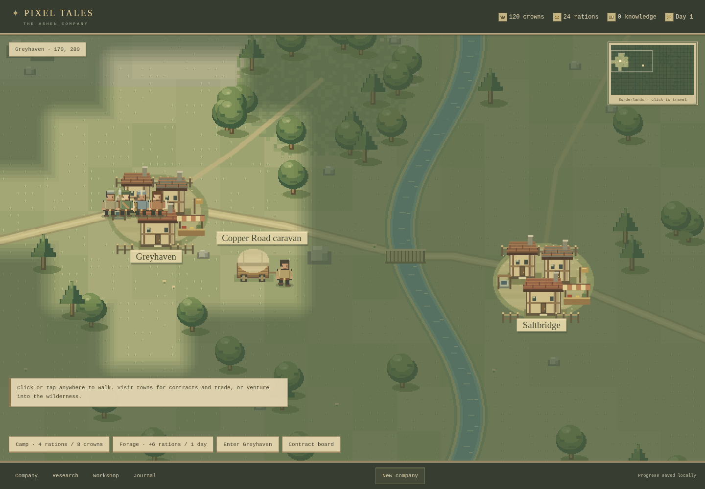
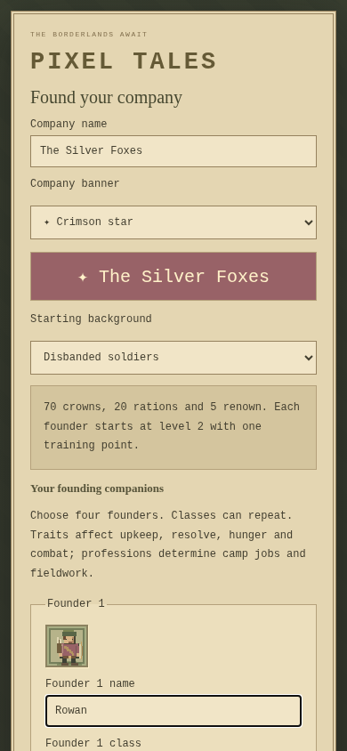
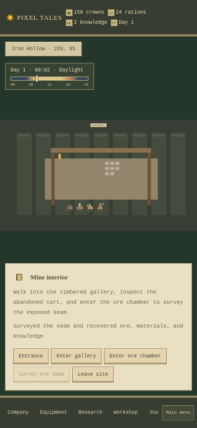
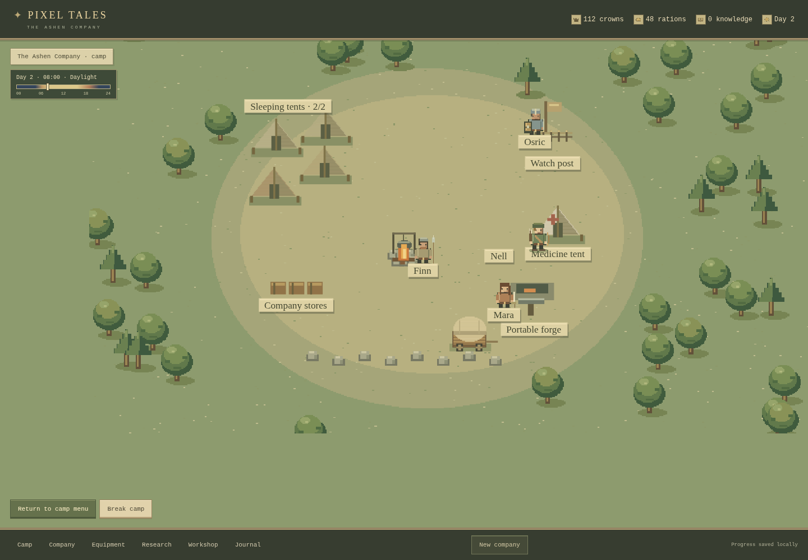
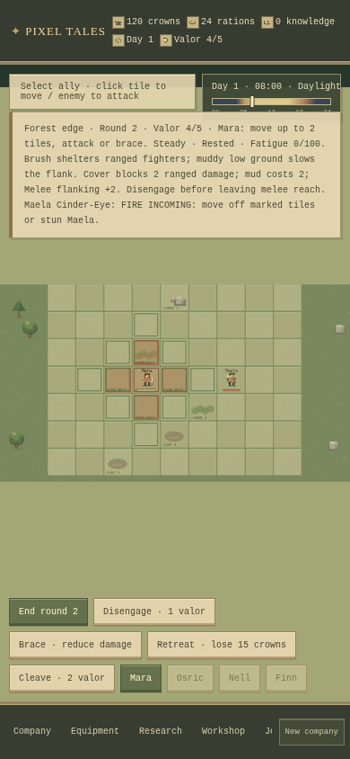
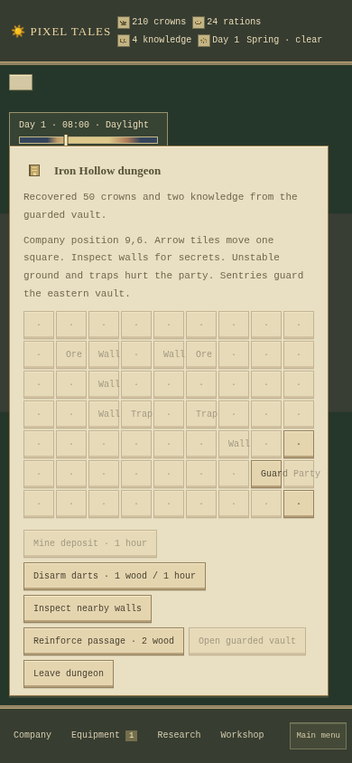
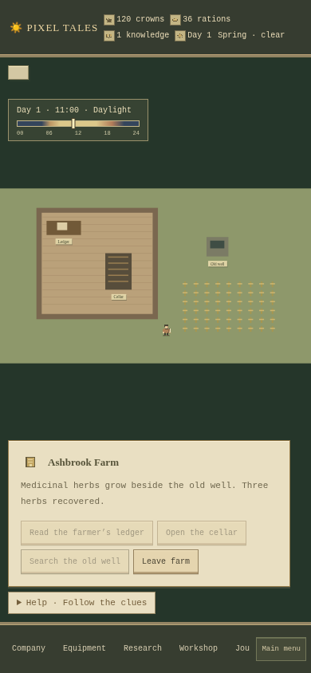

# Pixel Tales — The Ashen Company

An original, playable high-fantasy mercenary-company RPG with compact pixel visuals, tactical combat, company survival, staffed camps, regional trade, faction stories, research, professions, crafting, and character progression. No borrowed game assets. This is an early browser prototype; it is not yet a native Android app or a complete Wartales-scale game.

## The visual style

The art uses an original, earthy pixel palette inspired by the compact overworld presentation of Occidental Heroes: olive meadows, stepped tree canopies, warm plaster and timber buildings, and restrained parchment menus. Companions have distinct coats, faces, weapons, and portraits. Covered caravans, market stalls, wells, fences, ruins, mines, riverbanks, and a plank crossing give locations more character. Scenic footpaths do not restrict where you can walk.



[Village menu preview](docs/screenshots/village.png) · [Tactical battle preview](docs/screenshots/battle.png) · [Regional trade preview](docs/screenshots/trade.png) · [Story choices on mobile](docs/screenshots/story-mobile.png)

All artwork is drawn locally from `src/art.js`, with cached terrain and sprite images. There are no downloaded game assets, external fonts, or network requests required to render it. The world navigator uses the same terrain artwork. Unexplored land fades through a soft pixel edge; combat uses clearer selection outlines, names, and health tracks.

## Play

**No installation:** Download the repository ZIP from GitHub's Code menu, extract it completely, and open `index.html` in a JavaScript-enabled browser. Keep `index.html`, `style.css`, and `game.bundle.js` together. The included classic JavaScript bundle works without ES-module imports or remote fonts.

**Development server:** Requires Node.js 18+ and Python 3; no dependencies or secrets.

```sh
npm start
```

Open the server on port 3000. If that port is already in use, reuse the existing server or run `python3 -m http.server 3001` after `npm run build`.

**GitHub Pages:** The included workflow tests, builds, and deploys the game when pushed to `main`. The repository owner must enable **Settings → Pages → Build and deployment → Source: GitHub Actions**. Then rerun **Actions → Test and deploy game** if necessary. The Actions deployment reports the actual playable URL. Viewing `index.html` on github.com shows its source, not the game.

## Title menu and founding a company

The game opens on a title menu. **Continue** resumes the autosave; it is disabled when there is no readable company. **New Company** opens a creator without touching your current save. **Load** manages three manual save slots. **Settings** offers larger interface text, reduced motion, and ten-minute exploration days instead of five. Timed actions retain their stated durations. Title and creation menus pause the game.

Name the company, choose one of four banners, and customize all four founders: name, class, profession, and personality trait. You can repeat classes. Portraits and stat previews update as you choose; the creator shows the resulting daily food and wage costs. Banner colors carry into founder portraits, map sprites, camp, and combat. Trait tradeoffs apply to actual gameplay: mercenaries gain attack and demand higher wages, while hearty founders start with 32 health and consume extra food.

| Background | Starting company |
| --- | --- |
| Road wanderers | 120 crowns, 24 rations; balanced novice company |
| Caravan survivors | 180 crowns, 18 rations, 4 grain; trading capital |
| Frontier settlers | 80 crowns, 32 rations, 6 wood, 4 herbs; camp supplies |
| Disbanded soldiers | 70 crowns, 20 rations, 5 renown; level-two founders with one training point each |

Choose **Begin adventure** to start in Greyhaven. If you already have a company, the game asks before replacing its autosave. Cancelling creation keeps your save. Use **Main menu** during play to pause, change settings, or save a manual snapshot under **Load**. Loading a slot asks before replacing the autosave; the other slots remain intact. Manual saves and settings stay in this browser and origin. When storage is blocked, the company remains playable for the session and Continue works until the page is closed or reloaded.



## Avatars and interactive sites

Founders can be male or female independently of their class. Choose skin tone, hair color, short/long/braided hair, and individual coat colors in the company creator. Portraits, map sprites, camp companions, and combat sprites use these choices. Existing companions can be edited through **Company → Customize avatar** outside encounters and combat. Appearance does not change combat stats.

At **Forgotten Stash**, choose **Enter Forgotten Stash**. The broken oak and inscription form a ground-search puzzle. Find the buried chest, then use the lockpick dial to set three pins. Test tension for directional feedback; three mistakes reset the pins and cost one hour. Progress survives reloads. Opening the chest reveals its contents, including any accepted rumor find. Choose individual items or take everything; leftovers stay in the chest for later visits and cannot be collected twice.

**Iron Hollow** and **Redstone Quarry** are enterable mines. Move between the entrance, timbered gallery, and ore chamber. Inspect the abandoned cart for a one-time ore find and survey the seam for normal exploration materials and knowledge. Leave the interior to resume free map travel or repeatable fieldwork. Site visits pause the exploration clock, while explicit lock repair costs still advance it.



Roaming wolf packs now use actual wolf sprites on the map as well as in tactical battles. Their existing pack hunting behavior and wolf rewards remain active.

## Free exploration

The map fills the game screen. **Click or tap any ground** to set your own destination; the party walks there with animated companions following the route you actually took. Click again to redirect, use **Stop walking** to halt, or hold **WASD / arrow keys** to steer. There are no preset travel paths. Optional journal travel controls set a destination that you can redirect freely. The camera follows the company on narrow screens, keeping sprite proportions intact.

Towns and other sites offer actions only when you are within 64 world pixels of villages or 54 pixels of other sites. Arriving at a village stops the party and opens its places menu: visit the market for supplies, the blacksmith to buy and equip weapons or armor, the tavern to recruit companions, or the contract board for paid work. Available contracts appear only at village boards; your accepted objective remains visible during exploration. Management menus are overlays opened from the bottom toolbar; opening one pauses walking. Close the panel to return to exploration. You can forage and pitch camp anywhere. A full day takes **five minutes of active exploration**, independent of walking distance. Shallows slow travel. Menus, pitched camps, battles, encounters, and hidden browser tabs pause the exploration clock. Foraging and fieldwork advance six in-game hours; construction takes two hours. Saves retain your exact position and time, and reload safely stopped.

## The living borderlands

The world is now **1536 × 864**: four times the original area, with twelve locations. Emberfall, Whispering Grove, Sunken Chapel, Redstone Quarry, Forgotten Stash, and Broken Crown extend the frontier. Greyhaven and Saltbridge are known initially; other places are discovered within 140 pixels, awarding one knowledge each. Terrain is permanently charted as you walk. Contract destinations remain marked even before discovery.

The small **world navigator** in the top right shows your charted terrain, known landmarks, current viewport, and destination. Click any point there to start a long journey; supplies and encounters still apply. It selects a coordinate, not a predetermined path.

A caravan, three bandit groups, and two forest wolf packs roam independently while exploration is active. Hostiles approach nearby companions; wolves pursue only within forests. They pause during menus, battles, and encounters. Within 48 pixels, buy provisions from the caravan, attack its guards, or confront a bandit group. Attacking peaceful traders costs 10 morale and up to 5 renown once, and permanently ends trade with that caravan, even after retreat. Winning a caravan raid grants 60 crowns, up to 10 remaining rations, available trade cargo, knowledge, salvage, and XP; it grants no renown. Combat is optional: steer away if the company is unprepared. Patrol victories award 40 crowns, knowledge, salvage, and XP without completing or clearing your contract. Defeated patrols stay defeated after reload. Wolf battles use actual wolf sprites and enemies, awarding six rations, two pelts, one knowledge, two renown, and 20 XP per survivor; they do not drop human equipment. Sell pelts for three crowns each at village markets.

Research **Watchful eyes** for a 210-pixel discovery radius, **A fair bargain** for cheaper purchases, and **Borderlands charts** (requires Watchful eyes) to reveal landmark locations without exploring their terrain. Hidden stashes offer one-time crowns and medicine. Road events now include wounded travellers, abandoned camps, and storms with different choices and costs.

## Scouting and trail encounters

[Trail choices on mobile](docs/screenshots/trail-choices-mobile.png) · [Saved trail journal](docs/screenshots/trail-journal-mobile.png)

Outside villages, choose **Scout surroundings · 1 hour** on the world map. You can scout **once in each region per day**: the Greyhaven marches, Salt coast, and Ember frontier. The terrain at your actual position chooses the encounter pool. The day, map area, and saved encounter sequence vary the selection and avoid immediate repeats; reloading an unresolved encounter keeps its options. Crossing into another region gives another opportunity, while returning to the same region on the same day does not reset its limit.

| Terrain        | Encounter pool                              | Useful companions or standing                              |
| -------------- | ------------------------------------------- | ---------------------------------------------------------- |
| Forest         | Wounded tracker; poachers' snares           | Herbalist, medicine, Freefolk recognition                  |
| Highlands      | Overturned ore cart; old prospecting marker | Miner, including an Apprentice-rank option                 |
| River shallows | Washed-out crossing; river fishers          | Smith, Cook, Warden recognition                            |
| Grassland      | Stranded cloth wagon; unofficial road levy  | Smith, cloth trade cargo, Warden standing, Mercenary trait |

Choices show their exact resource costs, profession or reputation requirements, time, and consequences. They can improve faction standing, yield supplies, provide knowledge, or add profession practice. Seizing goods and exploiting travellers damages reputation; compassionate companions also react to certain selfish choices. Cargo rewards respect the shared 20-slot capacity. Required workers must be conscious, and unavailable choices stay disabled. **Walk away** is always available and grants no reward; the region remains scouted for the day.

The normal three-day roadside-event rhythm mixes these encounters with the existing wounded courier, storm, and abandoned camp. Scouting and time-consuming choices apply fatigue and normal midnight upkeep. The decision itself pauses time and walking. Accepted contracts remain active throughout. **Company → Trail journal → Recent encounters** remembers the last twelve outcomes, including faction and resource effects, across saves.

## Camp, upkeep, and daylight

**Make camp** opens a separate campsite with visible bedrolls, a campfire, supply crates, and companions. Build portable improvements in the Camp menu, use the workshop, forage, or rest until the next 08:00. **View camp** shows the scene; **Break camp** resumes the overworld. Planning costs no time. Improvements travel with the company and persist after saving.

| Improvement    | Initial cost               | Effect                                                            |
| -------------- | -------------------------- | ----------------------------------------------------------------- |
| Sleeping tents | 20 crowns, 6 wood          | +5 rest healing per level; two levels, second costs twice as much |
| Cookpot        | 15 crowns, 3 wood, 2 ore   | Reduce daily rations by one                                       |
| Portable forge | 30 crowns, 4 wood, 6 ore   | Fine gear recipes use one less ore while camping                  |
| Watch post     | 20 crowns, 5 wood, 2 ore   | +40 discovery radius and +1 starting battle valor                 |
| Medicine tent  | 25 crowns, 4 wood, 8 herbs | +6 rest healing; cure injuries when recovery reaches half health  |

At midnight, the company consumes **normally one ration and pays two crowns per living companion**. Cook ranks reduce rations by up to two, Trailcraft reduces them by one, and a cookpot reduces them by one, with a minimum of one ration for a surviving company. Unpaid wages accumulate as debt and lower morale; settle them in Company or Camp. Mercenary recruits demand three crowns and hearty recruits eat one extra ration. Inn prices include actual wages and overdue pay.

Missing food causes increasing health loss each hungry day, starting at three damage and rising to eight. Partial meals reduce damage; a fully supplied daily meal resets hunger. Hungry rest does not heal. Running out of rations allows continued travel so you can seek food, but prolonged starvation kills companions permanently. Warnings show hunger and wage debt.

The visible time scale tracks midnight, dawn, daylight, dusk, and night. The map dims gradually at sunset and brightens at dawn, with warm lanterns and campfire light at night.



## Camp duties and fatigue

Camp improvements now support **assigned jobs**. Open **Make camp → Camp duties**, build the required station, and choose a conscious companion. Each companion can hold one duty. Cook, Smith, and Herbalist duties require the matching current profession; anyone can guard. Changing to an incompatible profession clears the assignment. Duties persist after packing up or reloading, and assigned companions appear at their stations in the campsite.

| Duty        | Station        | Effect                                                                                                                               |
| ----------- | -------------- | ------------------------------------------------------------------------------------------------------------------------------------ |
| Camp cook   | Cookpot        | Save one additional ration per daily meal while camping; gain Cook practice after a fed rest                                         |
| Camp smith  | Portable forge | Fine recipes use one extra ore less while camping; a fed rest converts one wood into two ore plus Smith rank and grants two practice |
| Camp medic  | Medicine tent  | A fed rest uses two herbs to restore four extra health plus two per Herbalist rank to everyone and grants practice                   |
| Night guard | Watch post     | A fed rest prepares one extra valor for the next battle, consumed when that battle starts                                            |

Rest jobs need **at least six hours and a fed company**, and run at most once per day. Missing inputs skip the corresponding job without charging materials. Guard preparation caps at one and stacks with the watch post up to the five-valor maximum.

Companions gain **two fatigue per awake hour**, including exploration, foraging, fieldwork, and construction. At **50 fatigue**, attacks lose one damage; at **80**, attacks lose two and movement loses one tile. Fatigue caps at 100. Company shows each companion's fatigue and current penalty; exhausted companies also show an overworld warning. Menus and battles pause fatigue with the clock.

Fed camp rests recover five fatigue per hour for resting companions and three for companions on duty. Hungry rests recover only one per hour and produce no job rewards. Inn beds reset fatigue for living companions. You can leave a duty vacant when its worker needs a better rest.

## Companion character and relationships

Open **Company → Character & bonds** to see traits, personal resolve, daily costs, and relationships. New founders have distinct personalities; existing saves gain their founders’ traits while keeping progress.

| Trait           | Effect                                                                               |
| --------------- | ------------------------------------------------------------------------------------ |
| Resolute        | Lose half as much personal resolve from hardship                                     |
| Steadfast       | Bracing beside a trusted friend protects them from two damage rather than one        |
| Compassionate   | Medicine builds stronger bonds; peaceful caravan attacks cost eight personal resolve |
| Convivial       | Sharing supper grants one extra bond point                                           |
| Tireless        | Gain 1.5 fatigue per awake hour instead of two                                       |
| Mercenary       | Gain one attack, demand three daily crowns, and lose more resolve over unpaid wages  |
| Hearty appetite | This recruit starts with 32 health, but consumes an extra daily ration               |

Taverns offer a standard 60-crown recruit, an 80-crown mercenary swordswoman and Smith, and a 50-crown hardy spearman and Cook. Names vary by village. Review their health, profession, traits, wages, and rations before hiring. Specialist offers disappear permanently once hired. Capacity remains six living companions; replacing someone who died begins with fresh bonds.

Personal **resolve** starts at 65 and ranges from zero to 100. Hunger, overdue pay, prolonged exhaustion, defeat, and starvation deaths reduce it. Fed daily meals, rest, medicine, victory, and camp conversations help rebuild it. Below 25, a disheartened companion loses one attack damage. Resolve is separate from company morale.

Bonds grow from supplied daily meals (+1), fed rests of at least six hours (+2 once per day), shared victories (+3 for conscious survivors), and treatment by a Herbalist (+2, or +3 if compassionate). Levels are **Familiar at 10**, **Trusted at 25**, and **Sworn companions at 50**.

At **Make camp → Supper & stories**, select two companions to spend two rations and two hours together, once per day for the company. They gain four bond points and eight resolve each; a convivial participant adds one bond point. Self-targeting, unconscious participants, and insufficient food are blocked.

In battle, standing next to a conscious trusted friend grants **+1 attack**, provided the attacker is not disheartened. A trusted friend who braces beside you protects you from one damage, or two if steadfast. These bonuses do not stack with additional friends, and support disappears when a friend falls or moves away. Relationships also make starvation bereavement more painful.

[Recruitment preview](docs/screenshots/recruitment.png)

## Positioning and enemy tactics

**Melee flanking** adds two damage when a living ally stands directly opposite you across the target. It works for basic attacks and class abilities in melee, and enemy melee fighters can flank your companions too. Bows do not receive the bonus. Bracing and armor still reduce incoming damage.

Wolves can move **two tiles per enemy turn**, prefer reachable wounded companions, and deal one extra damage when another living wolf is adjacent to their victim. Rooting prevents their rush; stunning skips their turn. Bandit melee fighters advance and exploit flanking, while archers retreat from adjacent threats and shoot from range. Enemy hover text and the combat instructions describe these behaviors.

## Village services and company standing

Each village has four local contracts. Greyhaven introduces mercenary work around Pinewatch and Old Barrow; Saltbridge sends you to the chapel and eastern forests; Emberfall offers quarry and frontier jobs. Available offers remain exclusive to village boards. Existing accepted contracts continue to work after updating.

Company standing advances at **5 renown** (Proven company), **15** (Veterans), and **30** (Famed company). Boards show each job’s requirement and lock acceptance until you qualify. Combat contracts have real difficulty and reward differences:

| Difficulty | Enemies | Extra health / damage per enemy | Knowledge | XP per survivor | Renown |
| ---------- | ------- | ------------------------------- | --------- | --------------- | ------ |
| Standard   | 3       | None                            | 2         | 35              | 5      |
| Dangerous  | 4       | +4 / +1                         | 3         | 45              | 10     |
| Elite      | 5       | +8 / +2                         | 4         | 55              | 15     |

Each combat victory also grants 2–4 ore and wood according to difficulty. Patrols and caravan raids retain their existing rewards. Peaceful caravan attacks reduce renown, which can close access to advanced work until you rebuild your standing.

At the **Market square**, sell spare ore (2 crowns each), wood or herbs (1), and medicine (4), individually or as a whole stack. Purchase prices exceed resale prices. At **The Crooked Lantern**, resting costs **4 crowns for beds plus each companion’s daily wage**, including beds, meals, and wages, plus any overdue wages. It takes one day, uses no rations, restores living companions to full health, cures injuries, and adds 15 morale up to 100. Recruitment remains a separate service.

## Equipment and battle loot

Open **Equipment** from the bottom toolbar to manage your company’s named weapons and armor. Each victory over human enemies adds one item to company stores: Standard encounters and patrols drop Common gear, Dangerous contracts drop Fine gear, and Elite contracts drop Rare gear. Loot stays unequipped until you assign it.

| Quality | Weapon bonus | Armor bonus | How to acquire                                         |
| ------- | ------------ | ----------- | ------------------------------------------------------ |
| Common  | +2 attack    | +1 armor    | Standard fights or village blacksmiths                 |
| Fine    | +3 attack    | +2 armor    | Dangerous fights, blacksmiths at 5 renown, or crafting |
| Rare    | +4 attack    | +3 armor    | Elite contracts                                        |

Swords fit swordswomen, maces fit shieldbearers, bows fit archers, and spears fit spearmen. Armor fits everyone. Each companion wears one weapon and one armor item. Equipping a replacement returns the previous item to company stores; transferring an item removes it from its previous wearer. Comparison text shows the change for your selected companion. Gear bonuses add to permanent workshop improvements, research, and talents, and equipped armor actually reduces incoming damage.

Buy gear at a village **Blacksmith**, then assign it in Equipment. While in a village, unequipped gear can be sold from the inventory for 40% of its normal price. Equipped gear must be removed before selling. Barter research discounts purchases. Rare equipment is not sold by shops.

Research **Armorer’s craft** (5 knowledge, requires Tempered steel) to unlock Fine recipes in **Workshop**. Weapons use 5 ore and 2 wood; armor uses 6 ore and 1 wood. Each Smith rank reduces ore cost by one, and crafting grants two Smith practice. Gear cannot be changed, bought, sold, or crafted during combat or roadside encounters.

[Equipment inventory preview](docs/screenshots/equipment.png)

## Company development and tactical abilities

Every class starts with an active ability. Select a companion, press its ability button, then click an outlined enemy. Press **Basic attack** to cancel aiming. Abilities use the companion's action and shared **valor**, and have a two-round cooldown: use in round one, unavailable in round two, available again in round three. Valor starts at three, caps at five, regenerates one per completed round, and gains one from bracing or an enemy kill.

| Class        | Ability     | Cost    | Effect                                                |
| ------------ | ----------- | ------- | ----------------------------------------------------- |
| Swordswoman  | Cleave      | 2 valor | +2 damage; hits the target and enemies adjacent to it |
| Shieldbearer | Shield bash | 1 valor | +1 damage; stuns the target for its next turn         |
| Archer       | Aimed shot  | 2 valor | +4 damage; reaches five tiles                         |
| Spearman     | Lunge       | 1 valor | +2 damage; reaches three tiles                        |

At level two, spend one training point in **Company → Class abilities & specialization** to choose a permanent branch. This competes with strength and vitality training.

| Class        | Branch one                               | Branch two                                          |
| ------------ | ---------------------------------------- | --------------------------------------------------- |
| Swordswoman  | Duelist: +2 attack                       | Reaver: cleave causes two turns of bleeding         |
| Shieldbearer | Bulwark: bracing shields adjacent allies | Stalwart: shield bash stuns for two turns           |
| Archer       | Marksman: +1 basic and skill range       | Trapper: aimed shots prevent movement for two turns |
| Spearman     | Skirmisher: move three tiles             | Bloodletter: lunge causes two turns of bleeding     |

Bleeding deals two damage per enemy turn, ignoring armor. Rooted enemies can still attack if in range. Enemy archers shoot from four tiles and retreat from adjacent companions; brutes deal more damage and have armor. Hover over an enemy to inspect health, armor, range, and status.

Each profession ranks up at **3, 8, and 15 practice**: Apprentice, Journeyman, and Master. The best conscious worker supplies the company bonus. Switch professions with the Company dropdown; experience in each profession is retained independently.

| Profession | Practice sources                                                  | Rank benefits                                                                                              |
| ---------- | ----------------------------------------------------------------- | ---------------------------------------------------------------------------------------------------------- |
| Smith      | Crafting weapons and armor                                        | Reduce ore costs by one per rank, minimum one                                                              |
| Miner      | Exploring and working mines                                       | +2 ore per rank when exploring or working                                                                  |
| Herbalist  | Exploring forests, fieldwork, foraging, making and using medicine | Better herb yields, +3 medicine healing and +2 camp healing per rank; two medicine per craft at Journeyman |
| Cook       | Camping and cooking provisions                                    | Lower daily food costs (minimum one), better camp morale, +2 crafted rations per rank                      |

Near a mine or forest, **Work mine / Gather herbs** is repeatable: it costs two rations and six hours and awards two practice to the worker. Exploring remains a one-time reward. Crafting medicine requires a conscious Herbalist; cooking requires a Cook; weapon and armor work requires a Smith.

## Cover, movement, and disengagement

Brush and rubble provide **2 cover against ranged attacks**, for either side. Mud costs **2 movement points**; units cannot walk through occupied tiles. Put melee companions on opposite sides of an enemy for **+2 flanking damage**. Leaving an adjacent melee enemy triggers its disengagement attack, at most once per round. Archers retreating from your companions face the same rule. **Disengage** spends your action and one valor to permit a safe move; a Scout hood makes the first disengagement of a battle free. You cannot attack afterward.

Wolves rush reachable wounded companions, move farther, and gain pack damage when hunting together. Bandit archers maintain distance, while their melee allies close in. Cover, shields, bracing, fatigue, resolve, and trusted companions all affect the outcome.

## Contextual battlefields

[Ruined courtyard](docs/screenshots/battle.png) · [Quarry battle](docs/screenshots/quarry-battle.png) · [River battle on mobile](docs/screenshots/river-battle-mobile.png)

Battles use seven contextual layouts with distinct terrain artwork and deployments. Pinewatch and roaming wolves use the familiar **Forest edge**; Whispering Grove uses **Fallen grove**, with trunks dividing the center. Ruins alternate between **Ruined courtyard** and **Collapsed halls**, based on the day and company victories. Mines and rocky patrol country use **Quarry shelves**. Caravan attacks and open-road patrols use **Caravan road**, with the wagon blocking an approach. Sunken Chapel and river encounters use **Flooded ford**.

Solid walls, logs, boulders, and wagons block **movement and line of sight**. Attack outlines appear only for targets you can reach and see. This includes spear attacks and advanced abilities; Piercing shot ignores armor and cover, while solid obstacles still stop it. Diagonal sight checks do not allow attacks through the corner of a wall. Secondary cleave and sweep targets also require a clear sight line.

Deep water blocks movement while allowing shots across it. The ford has an open central crossing and slower adjacent shallows. Cover still absorbs two ranged damage, and muddy ground still costs two movement points. Hover or point at a tile to see whether it is blocked, provides cover, or costs extra movement. Enemies navigate toward reachable melee positions or firing lines, taking routes around obstacles and choosing first steps they can afford.

Later fields spread the company between flanks and change enemy positions. Six-companion companies and elite groups have distinct, unobstructed starting cells. Layouts persist through battle reloads. Older saved battles keep their existing positions and the original open terrain; they gain the new layouts when the next battle begins.

## Advanced class training

[Advanced training on mobile](docs/screenshots/advanced-training-mobile.png)

Open **Company → Class abilities & specialization**. At **level 4**, companions with a level-two specialization can spend **two training points** to master one permanent advanced skill. These are the same points used for strength and vitality, so save points if you want advanced training. Training is disabled during battles and encounters. The chosen upgrade replaces the class ability in combat and keeps the companion's specialization effects; it does not add a second attack per round.

| Class        | Advanced path    | Valor / cooldown | Effect                                                                               |
| ------------ | ---------------- | ---------------- | ------------------------------------------------------------------------------------ |
| Swordswoman  | Sundering cleave | 2 / 2 rounds     | Reduce each victim's armor by 2 before cleave damage, for the rest of the battle.    |
| Swordswoman  | Reaping cleave   | 3 / 3 rounds     | Stronger cleave; heal 2 per enemy struck, up to 6, without exceeding maximum health. |
| Shieldbearer | Rallying bash    | 2 / 3 rounds     | Bash and stun; heal yourself and conscious adjacent companions by 3.                 |
| Shieldbearer | Shockwave bash   | 3 / 3 rounds     | Bash and stun the target and enemies adjacent to it.                                 |
| Archer       | Piercing shot    | 3 / 3 rounds     | Aimed shot ignores armor and terrain cover.                                          |
| Archer       | Quick shot       | 1 / 1 round      | Smaller damage bonus, lower valor cost, and faster cooldown.                         |
| Spearman     | Impaling lunge   | 2 / 2 rounds     | Hit an aligned target and the enemy immediately behind it.                           |
| Spearman     | Hamstring lunge  | 2 / 3 rounds     | Stronger lunge; root the target for two enemy turns.                                 |

Cooldowns count down after enemy turns. Existing saves keep their companions, gear, stories, and points; learned advanced skills also persist. Healing skills cannot revive unconscious or dead companions. Shieldbearer upgrades retain Stalwart's longer stun, spear upgrades retain Bloodletter's bleeding, and archer upgrades retain Marksman range or Trapper roots.

## Regional trade and caravan cargo

Visit a village's **Market square → Regional trade** to buy and sell grain, cloth, salt, and iron. Trade cargo has **20 total slots**, separate from rations and crafting materials. Greyhaven has cheap grain, Saltbridge cheap salt, and Emberfall cheap iron. Supply prices also vary by village. Stock is finite, and regional shortages raise the price of a requested good. Each shortage has eight units of demand; supplying the last unit grants League reputation once. Bulk sales price each unit separately as demand runs out. Stock and shortages refresh every three days.

Friendly caravans offer **View caravan cargo** when nearby. Their cargo and food stocks are finite and persist in saves. Raiding a caravan costs **12 League and 6 Warden reputation**, in addition to morale and renown penalties and compassionate companions' reactions. Victories take its remaining food and as much actual cargo as your company can carry; raiding does not create unlimited provisions.

## Equipment that changes tactics

Each companion has separate **weapon, armor, shield, and helmet** slots in **Equipment**. Shields cannot be used by archers or alongside two-handed weapons. Equipping a two-handed weapon returns a worn shield to stores. Equipment belongs to one companion at a time; death returns it to stores. Armor from the three defensive slots adds together.

| Uncommon equipment  | Fighting style                                                                               |
| ------------------- | -------------------------------------------------------------------------------------------- |
| Executioner's blade | Two-handed; basic attacks sweep an adjacent second enemy for half attack power before armor. |
| Long pike           | Two-handed; one extra tile of basic and skill reach.                                         |
| Barbed spear        | Basic hits inflict two turns of bleeding.                                                    |
| Duelist sabre       | Bracing retaliates against melee hits while the wearer survives.                             |
| Sentinel shield     | Bracing reduces incoming damage by two more points.                                          |
| Scout hood          | First disengagement each battle costs no valor.                                              |
| Captain's helm      | Bracing generates two valor instead of one.                                                  |

Fine gear can be bought at five renown or with ten Warden reputation. Research the armorer's craft and assign a Smith to craft fine equipment; a staffed camp forge reduces its ore cost further. Ordinary round shields, iron caps, and iron greatswords are also available.

## Equipment wear and repair

[Camp repairs on mobile](docs/screenshots/repairs-mobile.png)

Named equipment has **100 condition** when bought, crafted, looted, or migrated from an older save. Wear applies once when a battle ends, to equipment worn by companions who entered that battle. Spare items and newly awarded loot stay intact. Victory costs **15 weapon condition** and **10 defensive condition**; retreat costs **10** for every equipped item; defeat costs **20**. Walking, ordinary upkeep, and exploring do not damage gear. Permanent improvements and company-issue equipment do not wear.

At **25 condition or less**, the equipment bonus is halved and rounded down, with a minimum of one. At **zero**, it supplies no equipment bonus and its uncommon perk stops working. Broken equipment remains in the company, keeps its ownership and slot restrictions, and can be repaired. Class skills, specialization, and permanent improvements still work. Equipment cards show actual bonuses, condition bars, and repair quotes. Resale prices decrease with condition.

- **Village blacksmith:** repair individual items in **Blacksmith → Equipment repairs** or **Equipment** for the displayed crown price. Repair costs scale with the item price and missing condition. Equipped items can be repaired, but battles and encounters block repairs.
- **Camp forge:** build the forge, assign a conscious Smith in **Camp duties**, then choose **Open camp repairs**. Repairs consume ore and, for weapons and shields, one wood; each item takes two hours. Higher Smith ranks reduce the ore requirement. The worker gains one Smith practice per completed repair. Normal time and upkeep rules apply.

Repairs restore full condition and all equipment effects. Insufficient crowns, missing materials, and an absent or unconscious worker leave the item and stores unchanged. Repaired items and damaged gear persist in existing saves.

## Regional stories and factions

Regional stories are accepted **only at village contract boards**, using the same active-contract slot as ordinary work. Investigate the marked site, choose a branch, complete any required battle, and return to the issuing village for the final reward. Peaceful choices have real resource or reputation requirements. Completed choices remain visible in **Company**, and rewards cannot be claimed twice.

- **Greyhaven: Salt on the road.** Recover cargo for the League, feed refugees, or seize their shipment.
- **Saltbridge: Whispering Grove oath.** After the road story and five renown, defend the Freefolk in battle or back the timber merchants.
- **Emberfall: Claim to the Broken Crown.** After the grove story and fifteen renown, support the Wardens or Freefolk, or broker peace if both trust you.

The **Caravan League**, **Border Wardens**, and **Grove Freefolk** remember these choices. Reputation ranges from −30 to +30. At ten League reputation purchases are cheaper; at −10 they become more expensive. Ten Warden reputation unlocks fine equipment without the renown requirement. Ten Freefolk reputation adds two rations to foraging. Ordinary deliveries, bandit victories, wolf hunts, and relieved shortages also build relevant standings. Company shows the current standing, benefits, and accepted or completed stories without offering new contracts outside villages.

## Tavern rumors and exploration leads

Visit **The Crooked Lantern** to buy a round and hear local rumors. Each costs **eight crowns and one hour**. Greyhaven offers leads to Forgotten Stash and Iron Hollow; Saltbridge points toward Sunken Chapel and the Watchtower; Emberfall shares leads for Whispering Grove and Redstone Quarry. The Watchtower and grove rumors require five renown, and the quarry rumor requires ten.

Rumors mark landmark locations while leaving nearby terrain unexplored. They coexist with your active contract and with each other. Open **Journal → Exploration leads** to review what you heard or walk toward its landmark. Travel still uses the open map and can be redirected or stopped.

Explore the rumored site (or complete its stash or mine interaction) to recover its extra one-time find: crowns, materials, or knowledge in addition to normal exploration rewards. The journal then records the day it was confirmed. Heard leads and completed finds survive reloads; rumors cannot be purchased twice. Taverns do not sell leads for sites you have already explored. Listening across midnight still incurs normal food and wage costs.

## Village training halls

Choose **Visit Training hall** in a village arrival menu to buy profession lessons. Greyhaven teaches **Cook and Smith**, Saltbridge teaches **Cook and Herbalist**, and Emberfall teaches **Smith and Miner**. Assign a companion’s profession in Company before visiting a suitable tutor.

Each lesson grants **three profession practice** and takes **three hours**. Tuition starts at 24 crowns in Greyhaven, 28 in Saltbridge, and 32 in Emberfall, with 12 additional crowns per existing rank. A fair bargain discounts tuition by 20%, rounded up. Novices can train immediately; apprentices need five renown to continue, and journeymen need fifteen. Masters cannot purchase more lessons. Practice thresholds remain 3, 8, and 15.

A companion can complete only **one lesson per day**, across all villages and professions. That limit survives reloads and uses the day on which the lesson finishes. Other companions can train separately. Unconscious or fallen companions cannot take lessons.

Higher ranks improve existing fieldwork, crafting, ration savings, and staffed camp jobs. The whole company waits during a lesson and gains normal awake fatigue. Crossing midnight still consumes food and settles wages, including existing debt; tuition does not buy meals or lodging. Lessons are unavailable in the wilderness, during travel or encounters, or while camp is open.

## Advanced company research

The Research menu now extends the early discoveries into five permanent company upgrades. It shows why a discovery is locked, including its prerequisite, renown requirement, or missing knowledge. Research cannot be purchased during battles or roadside encounters.

| Discovery | Prerequisite | Renown | Knowledge | Benefit |
| --- | --- | --- | --- | --- |
| Food preservation | Trailcraft | 10 | 6 | One fewer daily ration, with a minimum of one |
| Marching discipline | Field medicine | 10 | 7 | Awake fatigue builds 25% more slowly; stacks with Tireless |
| Company charter | A fair bargain | 10 | 6 | Daily total wages reduced by 20%, rounded up; existing debt stays owed |
| Campaign maintenance | Armorer’s craft | 20 | 8 | Five fewer durability points lost after victory, retreat, or defeat |
| Tactical drills | Tempered steel | 20 | 8 | One extra starting valor; stacks with camp preparation up to five |

Discoveries persist in existing saves and cannot be purchased twice. Food savings stack with camp cooks, cooking pots, and profession bonuses. Maintenance protects equipped gear without repairing damage it already has.

## Named adversary bounties

Visit a village contract board to accept its named bounty. Bounties share the active contract slot with ordinary and story contracts; Company shows your progress without offering contracts elsewhere.

| Adversary | Village / destination | Required renown | Reward |
| --- | --- | --- | --- |
| Rook the Tollkeeper | Greyhaven / Old Barrow | 5 | 160 crowns, Tollkeeper’s shield, League and Warden standing |
| Ashfang | Saltbridge / Whispering Grove | 15 | 210 crowns, Ashfang’s tooth spear, Freefolk standing |
| Maela Cinder-Eye | Emberfall / Redstone Quarry | 30 | 320 crowns, Cinder bow, Warden and League standing |

Rook strengthens his living escort and hits harder below half health. Stun him to interrupt his rally. Ashfang rushes three tiles and heals surviving wolves on even enemy rounds; defeat the pack or stun its leader. Maela marks a cross of tiles for a fire volley on the following enemy turn. Move off the marked tiles, stun her, or defeat her before ending that round. Fire deals four damage through armor; the warning and pending volley survive reloads.



These unique items cannot be bought or crafted. Each bounty pays once and records its completion in Company. Retreat or defeat leaves an unfinished bounty available to retry; **Abandon bounty** on a village board frees the contract slot without marking it complete.

## Your first expedition

1. Create your company from **New Company → Begin adventure**, then choose **Visit Contract board** in Greyhaven’s arrival menu and accept _Wolves in human clothing_.
2. Close the panel and click toward **Pinewatch** on the map. You can take any route and stop anywhere along the way.
3. **Explore** to collect knowledge, ore, wood, and herbs, then **Engage raiders**.
4. Select a companion using their button or sprite. Outlined green tiles are movement options; outlined red enemies are attack targets. Each companion can move up to two movement points along unoccupied tiles **and** attack once per round. Bows reach four tiles, spears two, other weapons one. **Brace** trades your attack for damage reduction. End the round for enemy actions.
5. Victory awards crowns, knowledge, salvage, and XP. Train leveled companions in **Company**, unlock permanent upgrades in **Research**, make permanent improvements in **Workshop**, and assign battle loot in **Equipment**.
6. Return to a village, visit its **Market square** for supplies and its **Crooked Lantern** tavern to recruit up to six companions. Buy medicine, heal injured allies, or camp to restore health and morale. Use **Make camp** to open the camp, build improvements, and rest until the next 08:00. Daily upkeep applies at midnight.
7. Walk to Iron Hollow and the Watchtower, take additional contracts, and respond to roadside choices. Delivery contracts offer a noncombat source of income and knowledge.

Morale at 85+ grants +1 attack. Injuries impose −1 attack. Armor absorbs damage. Profession practice now unlocks ranks and company bonuses. Explorable sites have one-time rewards. Contracts are repeatable. Defeat rescues the company in Greyhaven at a cost; starvation deaths are permanent and cannot be reversed by medicine or resting. Fallen companions leave company equipment in stores and can be replaced at taverns while survivors remain. If everyone starves, start a new company.

Progress automatically saves in browser local storage during play. **New Company** asks before replacing the autosave when you begin the adventure. Version-one through version-twelve saves migrate, preserving permanent equipment improvements; an unreadable autosave disables Continue and is kept until you choose a replacement. Browser storage is specific to your browser and origin; moving from a local file to a hosted site does not transfer progress.

## Validate and develop

```sh
npm test
npm run build
```

Edit `src/game.js` (rules), `src/art.js` (pixel artwork), `src/app.js` (UI), and `style.css` (interface), then rebuild. Commit the generated `game.bundle.js` so downloaded copies run immediately. The build uses only Node's standard library.

A browser-driven smoke test also exercises combat victory, research, crafting, recruitment, delivery, reload persistence, a 390px mobile layout, village arrival menus, gear purchases, caravan trading and attacks, navigator travel, discovery beyond the original map, aimed shots, specializations, profession reassignment, and fieldwork. With a running server and Playwright Core installed in a temporary directory:

```sh
npm install --prefix /tmp/pixel-browser --cache /tmp/pixel-npm-cache playwright-core
PLAYWRIGHT_MODULE=/tmp/pixel-browser/node_modules/playwright-core/index.mjs node scripts/browser-smoke.mjs
PLAYWRIGHT_MODULE=/tmp/pixel-browser/node_modules/playwright-core/index.mjs node scripts/village-smoke.mjs
PLAYWRIGHT_MODULE=/tmp/pixel-browser/node_modules/playwright-core/index.mjs node scripts/equipment-smoke.mjs
PLAYWRIGHT_MODULE=/tmp/pixel-browser/node_modules/playwright-core/index.mjs node scripts/survival-smoke.mjs
PLAYWRIGHT_MODULE=/tmp/pixel-browser/node_modules/playwright-core/index.mjs node scripts/camp-jobs-smoke.mjs
PLAYWRIGHT_MODULE=/tmp/pixel-browser/node_modules/playwright-core/index.mjs node scripts/companions-smoke.mjs
PLAYWRIGHT_MODULE=/tmp/pixel-browser/node_modules/playwright-core/index.mjs node scripts/complete-systems-smoke.mjs
PLAYWRIGHT_MODULE=/tmp/pixel-browser/node_modules/playwright-core/index.mjs node scripts/advanced-skills-smoke.mjs
PLAYWRIGHT_MODULE=/tmp/pixel-browser/node_modules/playwright-core/index.mjs node scripts/durability-smoke.mjs
PLAYWRIGHT_MODULE=/tmp/pixel-browser/node_modules/playwright-core/index.mjs node scripts/trail-encounters-smoke.mjs
PLAYWRIGHT_MODULE=/tmp/pixel-browser/node_modules/playwright-core/index.mjs node scripts/battle-layouts-smoke.mjs
PLAYWRIGHT_MODULE=/tmp/pixel-browser/node_modules/playwright-core/index.mjs node scripts/bounties-smoke.mjs
PLAYWRIGHT_MODULE=/tmp/pixel-browser/node_modules/playwright-core/index.mjs node scripts/advanced-research-smoke.mjs
PLAYWRIGHT_MODULE=/tmp/pixel-browser/node_modules/playwright-core/index.mjs node scripts/training-halls-smoke.mjs
PLAYWRIGHT_MODULE=/tmp/pixel-browser/node_modules/playwright-core/index.mjs node scripts/tavern-rumors-smoke.mjs
PLAYWRIGHT_MODULE=/tmp/pixel-browser/node_modules/playwright-core/index.mjs node scripts/company-menu-smoke.mjs
PLAYWRIGHT_MODULE=/tmp/pixel-browser/node_modules/playwright-core/index.mjs node scripts/sites-avatars-smoke.mjs
```

It uses `/usr/bin/chromium` by default; override `CHROMIUM_PATH` or `GAME_URL` as needed. Desktop and mobile screenshots are written under `/tmp`. The village smoke test checks regional offers, renown locks and unlocks, resale, inn recovery, save persistence, and dangerous encounters. The equipment smoke test covers purchases, class restrictions, assignment and transfer, resale, research and crafting, combat restrictions, reloads, mobile layout, and new-company reset.

The survival smoke test covers camp construction and recovery, saved improvements, mobile camp controls, daylight brightness, starvation warnings and permanent deaths, and wolf combat.

The camp jobs smoke test checks duty restrictions, saved assignments, resource production and costs, ration savings, profession practice, fatigue recovery and battle penalties, guard readiness, staffed campsite artwork, and mobile controls.

The companion smoke test covers trait previews and hiring, daily costs, capacity, character and bond displays, camp conversations, persistence, trusted battle support, low-resolve warnings, and mobile layout.

The complete-systems smoke test checks regional stock depletion, trading routes and shortages, four equipment slots, shield/two-handed restrictions, branching story choices and rewards, faction battles, free disengagement, save persistence, and mobile menus.

The advanced-skills smoke test covers prerequisites, training costs, permanent choices, save persistence, mobile menus, upgraded combat actions, armor/cover piercing, specialization compatibility, and cooldowns.

The durability smoke test verifies broken-gear stats, village and staffed camp repairs, material costs, Smith practice, mobile menus, persistence, and retreat wear.

The trail-encounters smoke test verifies terrain selection, profession and faction gates, trait choices, cargo capacity, regional daily limits, mobile decision menus and journals, pending saves, clock pausing, and natural roadside encounters.

The battlefield smoke test covers contextual layouts, blocked movement, sight-restricted attacks and skills, terrain tooltips, deployment persistence, caravan fights, field artwork, and mobile combat.

Further development includes expanded regional stories and Android packaging.

The bounty smoke test checks village acceptance, named challenges, victory and completion persistence, wolf pack composition, saved fire warnings, escaping and interrupting volleys, mobile layout, and abandonment.

The advanced-research smoke test checks prerequisite and renown locks, knowledge costs, one-time purchases, saved discoveries, and mobile research controls.

The training-hall smoke test checks regional tutors, lesson costs and practice, daily locks, persistence, village navigation, mobile controls, and wilderness restrictions.

The tavern-rumor smoke test checks local leads, landmark discovery without terrain reveal, unchanged active contracts, journal travel, one-time finds, reloads, renown locks, and mobile controls.

The company-menu smoke test checks the title screen, customization and starting tradeoffs, paused time, manual slots, cancellation, replacement and loading, Continue, persisted settings, corrupt saves, blocked storage, and mobile controls. Existing gameplay smoke tests enter through the title menu using the shared helper.

The sites-and-avatars smoke test covers founder appearance, stash searching and lockpicking, saved pins and one-time loot, mine rooms and rewards, mobile interiors, and roaming wolf combat.


### Campaign expansion (0.24)

- **Playable dungeons:** use Explore dungeon at mines and ruins, then move through the interior grid. Inspect the concealed door, disarm traps, reinforce unstable passages, and mine deposits with a Miner. Defeat the guards before opening the vault; deposits, secrets, and treasure are saved and cannot be repeatedly looted.
- **Tactical actions:** Archers can set overwatch, Shieldbearers can protect adjacent allies with a shield wall, and companions can spend valor to push adjacent enemies into difficult terrain for extra damage. Preparing an ambush costs food and time and grants a full free company turn before enemies can respond.
- **Companion stories:** camp conversations offer personal goals with resource costs and permanent rewards. Support or refusal changes loyalty and relationships. Disloyal companions can be released, and refused companions may leave when wages remain unpaid.
- **Camp furnishing:** build and reposition a shared table, drying rack, and brazier across six spaces. They improve healing, staffed forge output, and storm shelter. Cooking, smithing, and treatment have visible camp activity.
- **Crime and pursuit:** attacking caravans creates witnesses and a wanted level. Stolen cargo sales increase attention, and pursuing Wardens can intercept the company. Village fines clear the warrant and surrender carried trade cargo; faction reputation still remembers your attacks.
- **Weather and seasons:** rain and storms reduce discovery and enemy visibility, storms increase fatigue unless camp shelter protects you, and cold weather or winter raises daily food needs. Seasons change every seven days in a repeating calendar.

Existing companies migrate automatically. Dungeon position, furniture placement, personal decisions, crime, and ambush preparation persist through saves.

The campaign-expansion browser smoke test checks dungeon movement and guarded treasure, camp furniture and personal support, guard fines, tactical controls, weather, save/reload, and mobile layouts:

```sh
GAME_URL=http://127.0.0.1:3002/ PLAYWRIGHT_MODULE=/tmp/pixel-browser/node_modules/playwright-core/index.mjs node scripts/campaign-expansion-smoke.mjs
```




### Exploration and combat feedback (0.25)

**New exploration:** Ashbrook Farm lies south of Greyhaven. Its ledger unlocks the cellar and marks Briarhide Camp and Echo Cavern; surrounding terrain still needs exploration. Search the well and cellar for one-time supplies. The bandit camp and cave are playable dungeons. All eight dungeons have distinct, connected layouts, themed interiors, different secret and hazard positions, and vault rewards from 50 to 90 crowns. Existing Iron Hollow progress retains its original layout.

**Combat feedback:** companions and enemies animate between positions, hits flash, and floating numbers show health changes. Reduced Motion keeps sprites stationary during transitions and removes moving hit effects. Hover a target for expected damage including armor, ranged cover, and flanking. Hover a destination for disengagement and marked-fire warnings. Open **Target previews** for attack buttons, or **Movement previews** to choose a destination and read its risks before moving; both work with touch and keyboard. The action report shows the latest combat result. Attack previews show primary damage; equipment perks, area effects, bleeding, and healing can add further effects.

**Survival and difficulty:** forests yield eight rations per six-hour forage, farms ten, mines and highlands three, ruins four, and towns/open wilderness six. Each repeated forage at the same location that day loses two rations, up to a four-ration reduction and a minimum yield of two, before faction bonuses. Yields reset on the next day. Company displays daily food/wages, full days of supplies, debt-adjusted wage reserves, and time until the next meal. The field guide explains travel, combat, camps, dungeons, and discoveries; contextual Help remains available during play.

Choose a permanent **Campaign difficulty** when creating a company:

| Mode | Food | Wages | Enemy health / damage | Battle crowns |
| --- | --- | --- | --- | --- |
| Forgiving | 80%, rounded up | 75%, rounded up | 80% health, −1 damage | Standard |
| Standard | Existing costs | Existing costs | Existing strength | Standard |
| Veteran | 125%, rounded up | 125%, rounded up | 120% health, +1 damage | 115%, rounded up |

Food always costs at least one ration for a living company. Old saves retain Standard difficulty and migrate without losing progress. Weather, research, professions, staffing, and hiring still affect upkeep.

Run the exploration-feedback browser check with the existing development server:

```sh
GAME_URL=http://127.0.0.1:3002/ PLAYWRIGHT_MODULE=/tmp/pixel-browser/node_modules/playwright-core/index.mjs node scripts/exploration-feedback-smoke.mjs
```




## High fantasy and The Broken Road (v0.26)

Create human, elf, dwarf, or orc companions, including **Wizard** and **Cleric** founders. Their original pixel avatars show racial details and class equipment. Elves gain spell range but cost an extra daily crown; dwarves gain armor and cost an extra daily crown; orcs gain melee power and consume an extra daily ration. Casters also cost an extra daily crown. Race stays fixed when editing cosmetic appearance.

Magic is scarce on the frontier. Emberfall, a flourishing city, offers magical recruits, a focus staff, and paid temple services. Spellcasters use finite slots: two level-one slots at level one, three at level three, and four at level five. Level-two slots unlock at level three, with a second at level six. Slots stay spent between battles and after saving; ordinary rest does not restore them.

| Recovery | Cost per exhausted caster | Time |
| --- | --- | --- |
| Camp meditation | 2 rations and 2 herbs | 6 hours |
| Emberfall temple | 15 crowns | 2 hours |

Wizards cast Aether Dart, Stone Veil, and Cinderbloom; clerics cast Restoring Light, Sun Lance, and Shelter Oath. Stronger spells require herbs or ore as well as slots. Wards absorb one incoming hit. Healing cannot resurrect dead or unconscious companions. Clerics can also spend a level-one slot, an herb, and an hour to heal a conscious companion outside battle.

**Hungry Roads**, the playable first chapter of **The Broken Road**, begins at Greyhaven's contract board. Investigate Ashbrook Farm, escort Merrit to Saltbridge, and defeat Captain Venn at Briarhide. His stronghold sends raiders onto the map until cleared. Clearing it permanently removes those raiders and nearby road bandits. Decide whether captured grain goes to the League, hungry villagers, or your company; rewards, food prices, reputation, and crime consequences follow that decision. This chapter is independent of ordinary contracts. Further campaign chapters are planned, not implemented.

Rescue Sella and meet her again in Greyhaven. Rebuild Ashbrook for recurring harvests, or help Merrit establish a Saltbridge stall with discounted food. Escorts follow your company on the map; failed escorts can be accepted again. These consequences and one-time rewards survive reloads.

Supported companion stories now continue through a personal investigation and a camp decision. Sharing the discovery grants a class-specific ability; selling it earns money but damages resolve and relationships. Paid reconciliation can repair the conflict. Equipment gains more tactical purpose: stationary bows hit harder, serviceable spears can brace against approaching enemies, and guarding shields block enemies from crossing their lane.

[Setting and campaign direction](docs/THE_BROKEN_ROAD.md) · [Fantasy company creator](docs/screenshots/fantasy-company.png) · [Spell slots on mobile](docs/screenshots/spell-slots-mobile.png)

Saves migrate through version 14, preserving existing companies as human companions. Verify the new chapter, magic, recruitment, and mobile controls with:

```sh
GAME_URL=http://127.0.0.1:3002/ PLAYWRIGHT_MODULE=/tmp/pixel-browser/node_modules/playwright-core/index.mjs node scripts/broken-road-magic-smoke.mjs
```


## Caravans, road tolls, hiding, and selective loot (v0.27)

Four caravan loads travel independently: the mixed Copper Road caravan, Golden Sheaf wheat wagon, Ironbound armory wagon, and Silk Road cloth wagon. Open-backed wagons visibly carry wheat bundles, armor and shields, or cloth rolls. Trade their finite cargo; the armory also sells actual equipment. Purchases stay depleted after reload. Raiding an armory captures its remaining equipment alongside supplies and incurs the usual crime consequences.

Bandits automatically stop visible companies within 36 pixels. Before combat, choose between their crown demand, **8 rations**, or **Refuse · Fight**. Paying buys **eight game hours** of passage from that patrol, including after reload; it does not clear the stronghold. Wolves and authorities cannot be paid through this bandit menu.

**Hide company** activates a visible concealment meter. Standing still builds it faster in forests or at night. Sneaking travels at 55% speed and drains concealment; enemies within 22 pixels can expose you. At **60%**, authorities and other hostile patrols lose track of you. At **75%**, use a nearby enemy's **Ambush** action to attack directly with a full free opening turn. Finish that opening to refresh every companion's action and movement before any enemy responds. Spells still consume slots and reagents. Hiding preserves your wanted level; leaving hiding restores pursuit. Paid ambush preparation also remains available.

Village entry prompts now appear within **64 pixels**, and other site prompts within **54 pixels**. A dotted ring marks the current location's entry area. The nearest location wins if ranges overlap.

Forgotten Stash requires both the broken oak and marker-stone clues before the chest can be excavated. Checked squares and clues remain recorded. Lock pins show progress and strain; tension feedback guides the dial. Opening the lid shows a readable loot menu with individual selections, **Take all contents**, and the option to leave items behind.

Battles also include **Deadfall trail** and **Hedgerow road**, with variations selected from the encounter context and campaign day. Standing trees and fallen trunks block movement and line of sight. Bushes provide **1 ranged cover** and cost **2 movement points**; rubble still provides 2 cover. The path finder, enemy movement, ranged attacks, spells, and previews use the same terrain rules.

[Bandit negotiations on mobile](docs/screenshots/bandit-negotiation-mobile.png) · [Open stash and loot selection](docs/screenshots/open-stash-mobile.png) · [Deadfall battlefield](docs/screenshots/deadfall-battle-mobile.png)

```sh
GAME_URL=http://127.0.0.1:3002/ PLAYWRIGHT_MODULE=/tmp/pixel-browser/node_modules/playwright-core/index.mjs node scripts/roads-stealth-loot-smoke.mjs
```


## Scouting, fantasy foes, and company wagons (v0.28)

**Scouting requires a conscious Archer or a companion with the new Thief profession.** Assign an eligible companion to the travel scout duty for greater discovery range and faster concealment. Natural roadside events remain available to every company.

Survey Briarhide within 110 pixels, then infiltrate while concealed: steal provisions, rescue Edda (an orc Spearman and Thief), spend two ore to sabotage the defenders, or open a drainage entrance into the stronghold. Each operation is a persistent, one-time consequence and reduces concealment. Sabotage weakens the captain and his sentries; the drainage route provides a different dungeon entry. Defeating the leader still ends the raids.

Goblins lay visible snares, steal rations, and attempt to escape. Archers and Thieves can disarm adjacent snares. Skeletons hold formations and gain armor beside another skeleton. Spellbinders have two finite slots and mark the tile they will strike on their next turn: move away or interrupt the cast. New original pixel sprites distinguish these enemies on the road and battlefield.

Caravan escort jobs appear at their issuing village's contract board. Protect wheat, armor, cloth, or mixed loads on a freely chosen route and collect payment at the destination. Bandits can attack merchants independently. Intervene, demand 15 crowns before fighting, or leave; abandoned raids resolve after three game hours and leave persistent, limited wreck loot. Taking wreck supplies carries crime consequences. Entrusted cargo cannot be traded or attacked during its escort.

A company wagon is **purchased in a village for 250 crowns**, or **claimed free after completing Hungry Roads**. It follows the party and appears at camp and during battles. Owning it adds ten cargo spaces. Camp upgrades include:

| Upgrade | Cost | Effect |
| --- | --- | --- |
| Cargo racks, up to two levels | 50 crowns, 5 wood, 1 ore each | Ten cargo spaces per level |
| Portable workbench | 70 crowns, 4 wood, 3 ore | An assigned camp Smith repairs equipment without a forge and reduces fine crafting's ore cost |
| Reinforced rails | 60 crowns, 4 wood, 4 ore | Reduce wagon damage and supply losses on retreat or defeat |

Quartermasters save a daily ration; rear guards begin combat guarding and protect supplies during retreat. These travel duties require a wagon and each companion holds at most one travel duty. A conscious Smith can repair the wagon at camp for 20 crowns and two ore, taking two hours. A wrecked wagon's workbench and protection stop functioning until repaired; its cargo remains stored.

At level two, Wizards and Clerics can spend a training point on a permanent magical school:

| Class | School | Combat focus |
| --- | --- | --- |
| Wizard | Barrier scholar | Stronger wards and Bastion |
| Wizard | Elementalist | Greater spell damage, burning, and Firestorm |
| Wizard | Illusionist | Longer range and distracting Phantom/Mirage illusions |
| Cleric | Beacon guardian | Stronger protection and Sanctuary |
| Cleric | Restorer | Stronger healing, wound treatment, and Renewal |
| Cleric | Dawn zealot | Greater spell damage and interrupting Rebuke |

Specialized spells share the existing persistent spell slots and reagent costs. Level-two spells still require level three. Saves migrate through version 15 and preserve infiltration, wagon upgrades and duties, active escorts and raids, enemy casts and snares, and learned schools.

[Company wagon on mobile](docs/screenshots/company-wagon-mobile.png) · [Stronghold infiltration](docs/screenshots/infiltration-mobile.png) · [Caravan defense](docs/screenshots/caravan-defense-mobile.png) · [Magic specialization](docs/screenshots/magic-specialization-mobile.png)

```sh
GAME_URL=http://127.0.0.1:3002/ PLAYWRIGHT_MODULE=/tmp/pixel-browser/node_modules/playwright-core/index.mjs node scripts/frontier-expansion-smoke.mjs
```


## A changing frontier (v0.29)

This release expands the existing region and Hungry Roads systems; it does not introduce a second campaign chapter.

**Village allegiance and border guards.** Greyhaven begins under the Border Wardens; Saltbridge and Emberfall begin under the Caravan League. At a village, backing a faction charter costs 40 crowns and six rations, with a three-day local cooldown. The chosen faction gains six reputation, displaced rulers lose six, and other rivals lose two. Charters change the village's ruler and establish a border patrol. Friendly patrols leave travelers and merchants alone; hostile patrols intercept visible companies. Attacking a peaceful guard incurs crime and faction penalties. Defeated guards remain defeated after saving; a new charter reinforces the border.

Local reputation grants a ten-percent purchase discount at +10 and a twenty-percent surcharge at −10, alongside existing League modifiers. At −15, village services and recruitment require a **25-crown day pass**. Supporting a charter and maintaining at least six local reputation unlocks a one-time faction recruit: an elf Archer/Thief for the Grove Freefolk, a dwarf Spearman/Smith for the League, or a human Shieldbearer/Miner for the Wardens. Existing contracts and their faction requirements remain available through village boards.

**Companion heritage stories.** Discuss a living companion's heritage at camp, travel to their lead, and return to decide its fate. Elves investigate Whispering Grove, dwarves Iron Hollow, humans Ashbrook, and orcs challenge Commander Rhusk at Briarhide in an actual battle. Honor the discovery for improved trust and a permanent perk, sell it for fifty crowns at the cost of resolve, reconcile later for twenty-five crowns, or explicitly allow the companion to leave. Sanctuary lore permits one herb-funded level-one slot recovery per company day; ancestral lore improves company damage against undead; other honored stories improve the companion's health and resolve. These stories run alongside existing class/profession personal quests.

**Fantasy strongholds and safer roads.** Three persistent sites now have leaders, scouting reports, raiding routines, and different infiltration operations:

| Stronghold | Landmark | Leader | Disruption | Patrol window |
| --- | --- | --- | --- | --- |
| Bramble den | Echo Cavern | Mossfang | Burn stores: 3 wood | Dawn and morning |
| Barrow crypt | Old Barrow | Oathless Marshal | Consecrate seal: 3 herbs | Night |
| Outcast spire | Watchtower | Magister Vale | Break focus: 3 ore | Dusk |

Discovered strongholds can produce a patrol every three days, with at most two active waves each. Survey within 110 pixels using an Archer or Thief. Infiltration requires at least sixty-percent concealment. Disruption stops reinforcement waves and weakens the final defenders; destroying the arcane focus also reduces enemy spell slots. Defeat the leader to permanently stop patrols and remove the stronghold's existing roaming threats. Ordinary dungeon exploration remains available at these landmarks.

**Dungeon side chambers.** Each dungeon has an optional side chamber at tile 5,4. An Archer or Thief spots hazards and reads a rune clue. A Thief works through three lock tumblers with tension feedback and a penalty for repeated mistakes. Complete the rune sequence, or let a caster spend a persistent level-one slot to dissolve the seal. The chamber holds thirty-five crowns, two herbs, one aether shard, and knowledge, awarded once. It provides treasure that can be recovered without committing to the eastern sentries; retreat stays available. Scouts can also disable nearby dart mechanisms without consuming timber.

**Wagon travel incidents.** Owned wagons accumulate actual travel distance. After six hundred pixels outside settlements, at most one incident occurs per day: a cracked wheel, flooded crossing, overloaded bindings, or night raiders. Quartermasters handle wheels and overloaded cargo, scouts find safe crossings, and rear guards drive off raiders. Alternatives include spending timber, paying twenty crowns, risking actual food/cargo and wagon damage, or fighting the night raiders. Incidents pause movement and persist while pending; companies without a purchased/unlocked wagon never receive them.

**Tactical magic and rare recovery.** Wizards gain Veil of Night, Ember Ground, and Sever Spell; Clerics gain Hushed Ground and Beacon Circle. Ground spells use a labelled battlefield grid and show their affected area on the map. Darkness blocks distant line of sight while permitting adjacent combat. Silence prevents company casting and interrupts enemy channels without refunding slots. Fire ground damages both sides during enemy rounds. Beacon Circle renews nearby wards for three rounds, but damage to its caster breaks concentration. All new spells use the existing persistent slots and reagent rules.

Aether shards are finite loot from side chambers and the cleared Outcast spire. At camp, one shard and one hour restore one spent level-two slot, or up to two spent level-one slots. Regular meditation and Emberfall recovery remain available.

**Encounter journal and map leads.** The company journal now combines known strongholds, companion requests, rumors, recurring travelers, caravan destinations, village charters, and a saved chronicle of recent decisions. Track a known lead to mark its landmark and begin walking there. The party still chooses a free route. Journal history is bounded to eighty entries; save version sixteen sanitizes new state and migrates older companies.

[Village allegiance](docs/screenshots/territory-mobile.png) · [Companion heritage](docs/screenshots/heritage-mobile.png) · [Dungeon lock and runes](docs/screenshots/dungeon-runes-mobile.png) · [Wagon incident](docs/screenshots/wagon-incident-mobile.png) · [Tactical darkness](docs/screenshots/darkness-magic-mobile.png)

```sh
npm test
npm run build
GAME_URL=http://127.0.0.1:3002/ PLAYWRIGHT_MODULE=/tmp/pixel-browser/node_modules/playwright-core/index.mjs node scripts/realm-expansion-smoke.mjs
```


## Expedition systems (v0.30)

**Four tactical objectives.** Village contract boards now offer separate, one-time tactical missions: defend a supply wagon for four rounds, free and extract a captive, withdraw the conscious company across the battlefield, or break three ritual seals before the sixth enemy round. Killing the guards does not automatically finish an extraction or ritual. A conscious companion can take over a fallen rescuer's escort. Failed or abandoned battles do not pay rewards; an accepted mission remains available for another attempt. Objectives, progress, and interaction requirements appear in battle.

**Permanent class careers.** At level two, spend one training point to choose a career in Company management. Each class has two paths: Swordswoman Duelist/Vanguard, Shieldbearer Protector/Captain, Spearman Controller/Outrider, Archer Tracker/Sentinel, Wizard Channeler/Hexer, and Cleric Mentor/Avenger. The Thief profession additionally offers Shadow/Saboteur. Techniques include counterattacks, shared protection, sweeping strikes, rooted approaches, marked targets, pinning overwatch, limited slot recovery, and support magic. Thief techniques require the profession to remain equipped. Choices persist across saves.

**Follow evidence through the world.** Footprints, smoke, lights, and buried road fragments form four trails, each with three separate observations. An Archer or Thief must approach and interpret each clue. Following the trail reveals its destination and grants a small, finite discovery reward; seeing the first clue does not reveal the entire route. Travel remains freely directed.

**Cooperating enemies.** Bandit shields protect nearby ranged fighters while guarding; attackers seek flanks and exposed targets. Goblins can wait behind snares, wolves favor isolated injured companions, and threatened casters retreat before committing another spell slot. Terrain, cover, movement obstacles, and existing enemy spell telegraphs remain relevant.

**Travel relationships.** Long journeys can pause for companion conversations, limited to once per day. Share food, listen, dismiss concerns, settle overdue wages, or promise payment by dawn. Meals and understanding build bonds; broken promises and dismissal can create persistent rivalries. Rivals refuse certain protective and healing techniques. Hunger, debt, fatigue, existing personal stories, and departure risks continue to affect the company.

**A permanent company home.** Visit Wayfarer Lodge and purchase a lodge or farm for 320 crowns and ten timber. Store supplies separately from traveling inventory. Build a storehouse, beds, treatment room, forge, and kitchen garden. A stationed Smith enables discounted crafting and equipment repairs; an Herbalist makes the treatment room effective. Rest consumes food and twelve hours, so wages still fall due. Gardens provide a bounded harvest every three days. One finite aether shard can restore a spent level-two slot or up to two level-one slots at home. The company wagon remains its separate traveling camp.

**Balance and readable requirements.** An exploration day now lasts five active minutes, or ten with slower days enabled. The Company outlook shows daily ration and wage costs, supply coverage, and time until dawn. New actions display specific requirements; a collapsible unavailable-actions list makes disabled controls understandable on touchscreens. Additional management sections are folded to keep the map usable. Save version seventeen migrates older companies and validates mission, career, relationship, observation, and property state.

[Wagon defense](docs/screenshots/wagon-objective-mobile.png) · [Class careers](docs/screenshots/class-careers-mobile.png) · [Observation trails](docs/screenshots/observation-trail-mobile.png) · [Company home](docs/screenshots/company-home-mobile.png)

Validation: 386 automated tests, a dedicated desktop/mobile expedition smoke test, and regression browser checks for company creation, campaign systems, the frontier, and the realm expansion.

```sh
npm test
npm run build
GAME_URL=http://127.0.0.1:3002/ PLAYWRIGHT_MODULE=/tmp/pixel-browser/node_modules/playwright-core/index.mjs node scripts/expedition-systems-smoke.mjs
```

## Regions, companion continuations and captives (v0.31)

**Distinct regional environments.** The current freely traveled map now has five geographic identities, with original scenery: Greyhaven's planted fields, the Salt Coast, the rocky Redstone Passes, the pale Whispering Wilds, and Emberfall's terraced dominion and academy spires. These deepen the existing map rather than opening a separate campaign.

| Region | Travel and resources | Local trade and services |
| --- | --- | --- |
| Greyhaven Farmlands | Irrigation obstacles; a Cook finds a safe route | Greyhaven sells one daily harvest bundle: 12 rations for 18 crowns |
| Salt Coast | Flooded fords; a Thief identifies safe crossings | Saltbridge sells one daily reed remedy bundle: 4 herbs and 1 medicine for 20 crowns |
| Redstone Passes | Scree falls; Miners find safe approaches; first daily gathering at a site adds ore | Ore-rich quarries and mountain battlefields reward exploration |
| Whispering Wilds | Ghost-mist and misleading lights; Herbalists find safe growth; first daily gathering at a site adds herbs | Wolves, goblins, haunted ruins and existing Freefolk services shape woodland travel |
| Emberfall Dominion | Unstable roadside wards; Wizards interpret safe routes | Existing cheap cloth/iron and scarce grain; academy gates provide costly arcane passage |

After 650 pixels of actual travel, a regional obstacle can appear outside settlements, limited to once per region each day. A conscious specialist finds a one-hour route and earns knowledge. Two rations and one timber secure a one-hour crossing. A three-hour detour adds fatigue; all elapsed time can cross midnight and charge wages and meals. Obstacles pause walking and survive reloading. View the regional atlas in Company management.

Emberfall's academy transports the company to a discovered Greyhaven or Saltbridge for fifty crowns, two hours, and a conscious caster's persistent level-two slot. Gates cannot transport a company wagon, escorted travelers or prisoners. Existing temple recovery remains a separate service. Magic remains costly and concentrated around the flourishing city.

**Six multi-stage companion continuations.** Complete a companion's first personal journey, then begin a follow-up at camp. Each combat class has a different story, witness, destination and recovered evidence. Hear testimony in the appropriate village, investigate a second landmark using two ore or herbs and two hours, then decide its meaning at camp. Choose a living quest partner there; changing partners does not bypass actual trust requirements.

| Class | Follow-up | Unique technique after an oath or reconciliation |
| --- | --- | --- |
| Swordswoman | The broken dueling oath | Oathstrike: adjacent attack with two additional power, then brace |
| Shieldbearer | Names beneath the barrow | Steadfast: give every conscious ally a two-point ward |
| Spearman | The watcher's last post | Holdfast: root enemies within two tiles for two rounds |
| Archer | The hunter's missing sister | Trueflight: expose visible enemies to stronger company attacks |
| Wizard | An apprentice's forbidden notes | Lastspark: recover one actually spent level-one slot |
| Cleric | The bell that forgot its dead | Mercy: heal all conscious allies by four health |

All personal techniques consume an action and are limited to once per battle, including after reloading. An oath requires at least ten bond with the living partner and settled wage debt. Restitution costs twenty-five crowns, repairs rivalry, and unlocks the technique through reconciliation. Alternatively, let the companion leave peacefully: they genuinely vacate the roster, their equipment stays in company stores, and the Freefolk recognize the decision. Outcomes and evidence persist; camp and Company menus expose requirements.

**Enemy surrender, fleeing and prisoners.** Wounded humanoids in ordinary battles can offer surrender after the opening round when outnumbered. Capture them, release them alive, accept eight crowns for safe passage, or refuse. Critically wounded enemies whose surrender is refused try to escape east; roots, disengagement attacks and overwatch can stop them. Escape loses their stolen supplies, and a fight in which every enemy escapes pays half the normal crown reward. Wildlife, undead, named adversaries, stronghold leaders, objective defenders, peaceful caravan defenders and pursuing authorities do not offer this ordinary surrender.

The company can keep at most three prisoners. A conscious Shieldbearer, Thief, camp guard or traveling rear guard provides supervision. Prisoners visibly follow the company and consume one additional ration each at daily upkeep; the supply forecasts include them. Two days without food or three days without supervision cause escape. Deliver a captive to a village guard for thirty crowns, or forty-five for a mage, and gain Warden standing. Releasing captives earns Freefolk standing; selling battlefield passage lowers Warden standing.

After two fed days, recruit a human captive at camp for sixty crowns if wages are settled and the roster has room. Their previous enemy role determines their combat class; they join as Thieves with the Mercenary trait and fifty resolve, introducing wage and loyalty tradeoffs. Goblins can be released or delivered for bounty but cannot join the current company. Dead/departed roster slots can be reused, with the previous owner's progression cleared.

**Visible and purposeful equipment.** Equipped weapons, armor, shields and helmets now appear consistently on world avatars, combat units, camp and interior sprites, and company portraits. Item quality and condition change their colors and silhouettes. Equipment comparisons show the full attack and armor change, shield loss from two-handed weapons, gained/lost perks, and broken-item effects.

Four finite relics add tactical choices. An Archer or Thief must locate them; recovery costs two knowledge, four listed materials, and two hours. Broken relics lose their special effect.

| Relic | Landmark and materials | Tactical effect |
| --- | --- | --- |
| Winterglass pike | Redstone Quarry · 4 ore | Basic attacks root the target for one round |
| Horizon bow | Watchtower · 4 wood | Two extra bow range while stationary; movement removes it |
| Spellbreaker blade | Broken Crown · 4 ore | Basic hits interrupt channels without refunding spent enemy slots, then silence for one round |
| Grovewarden helm | Whispering Grove · 4 herbs | Two additional damage reduction while standing in cover |

Save version eighteen migrates older companies and validates the new regional, companion, captive and relic ledgers. Validation: **429 automated tests**, a dedicated desktop/mobile browser check covering a complete continuation, capture/reload/bounty, two actual fed rests before prisoner recruitment, relic equipment and paid arcane travel, plus regression checks for previous systems.

[Regional atlas](docs/screenshots/regional-atlas.png) · [Companion oath](docs/screenshots/companion-oath-mobile.png) · [Enemy surrender](docs/screenshots/enemy-surrender-mobile.png) · [Equipment comparison](docs/screenshots/equipment-comparison-mobile.png)

[Farmlands](docs/screenshots/farmlands.png) · [Haunted woodland](docs/screenshots/haunted-wilds.png) · [Mountain passes](docs/screenshots/mountain-passes.png) · [Emberfall and equipped avatars](docs/screenshots/emberfall-city.png)

```sh
npm test
npm run build
GAME_URL=http://127.0.0.1:3002/ PLAYWRIGHT_MODULE=/tmp/pixel-browser/node_modules/playwright-core/index.mjs node scripts/odyssey-systems-smoke.mjs
```
